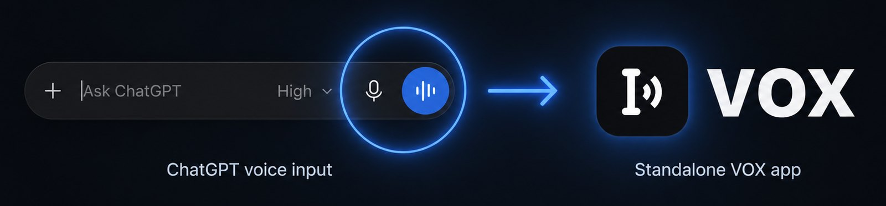
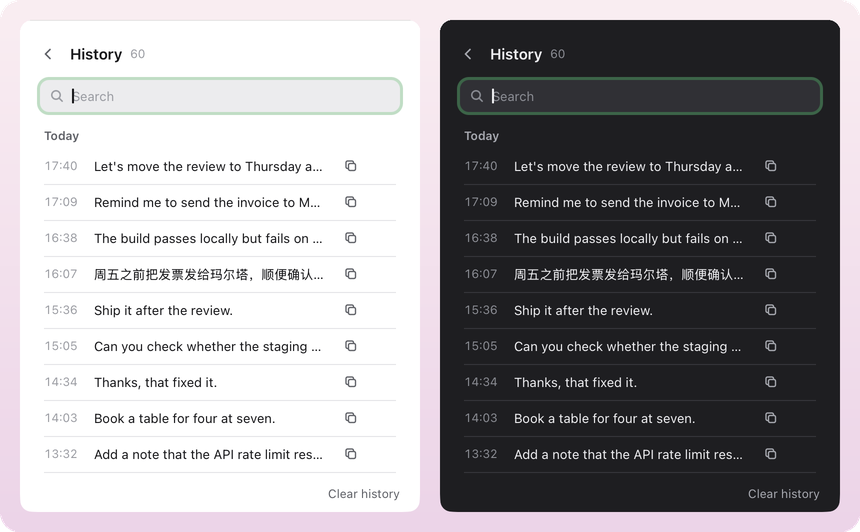
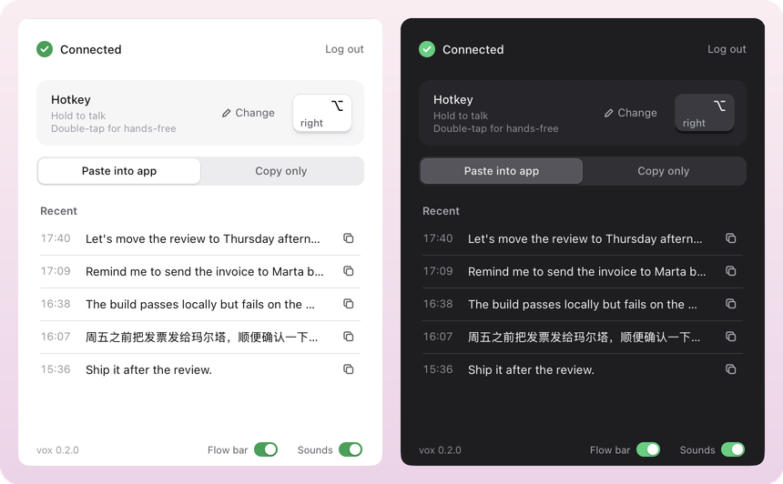

<div align="center">
  
  <p><b>Hold a key, speak, and the text appears in any app.</b><br>
  Dictation for macOS and Windows on your ChatGPT account. No API key.</p>
  <a href="https://github.com/ziyangliu-666/vox/releases/latest"></a>
  <a href="https://github.com/ziyangliu-666/vox/releases"></a>
  <a href="https://github.com/ziyangliu-666/vox/actions/workflows/build.yml"></a>
  
  
  <p><a href="https://github.com/ziyangliu-666/vox/releases/latest"><b>Download for macOS · Windows</b></a></p>
</div>

## Features

**Hold to talk, double-tap for hands-free.** Hold the hotkey while you speak. Double-tap it to keep listening; press once more to stop.


**A flow bar that stays out of the way.** Drag it to any screen edge. Guides show where it lands; it snaps to the middle or the thirds.


**Every transcript, searchable.**



**Any key you like.** Pick a single key or a combination. Light and dark mode. Chinese, English, and mixed speech.



## Install

- **macOS 12+, Apple silicon:** open `vox-<version>.dmg` and drag vox to Applications. On first launch, allow it in System Settings › Privacy & Security › **Open Anyway**.
- **Windows 10/11:** run `vox-<version>.exe`. If SmartScreen warns, click **More info › Run anyway**.

Then click **Log in with ChatGPT**, allow the microphone, and hold **Right ⌥** (Windows: **Right Ctrl**).

vox updates itself: when a new release is out, the window footer shows **Update to x.y.z**. On macOS, permissions carry over between versions.

## FAQ

**Is this an official ChatGPT app?** No. vox uses the private endpoint behind the dictation button on chatgpt.com. It can change without notice, and automated use breaks the ChatGPT terms of use. Use it at your own risk.

**Where does my audio go?** To ChatGPT only, from a chatgpt.com page that vox keeps open out of sight. vox never reads your login. Transcripts stay on your computer.

**Why Accessibility and Input Monitoring?** To see the hotkey while you work in another app, and to paste into it.

## Build

```sh
uv run vox                  # run from source
packaging/build_mac.sh      # dist/vox.app, dist/vox.dmg
packaging/build_win.ps1     # dist\vox.exe
```

Pushing a `v*` tag builds both platforms and publishes a release.
