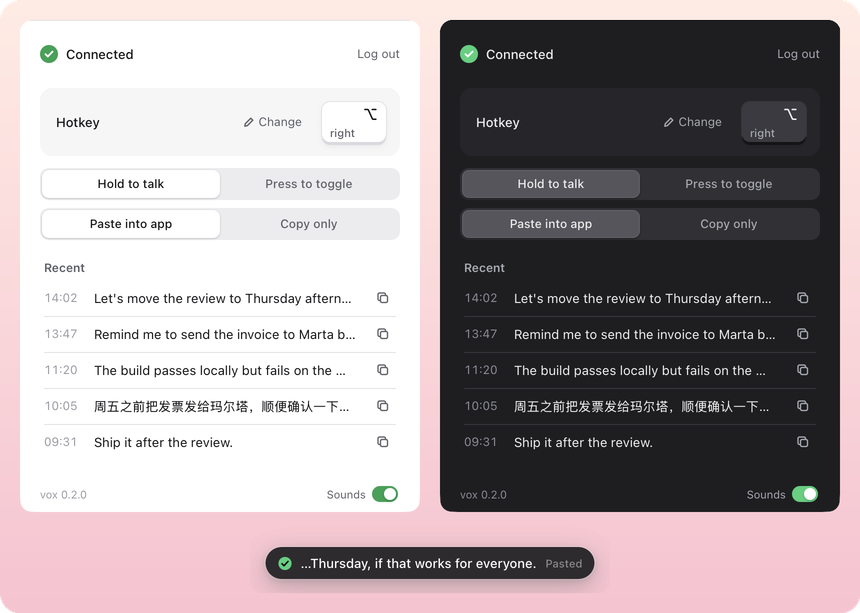

<div align="center">
  
  <h1>vox</h1>
  <p>Hold a key, speak, and your words appear in any app.<br>
  Push-to-talk dictation for macOS and Windows, powered by your ChatGPT account.</p>
  <p><a href="https://github.com/ziyangliu-666/vox/releases/latest"><b>Download</b></a></p>
  
</div>

## Features

- **Works everywhere.** Text goes into the app you are typing in: Notes, Slack, WeChat, your editor.
- **No API key.** vox uses the ChatGPT account you already have.
- **Any hotkey.** Hold to talk, or press to start and press to stop.
- **Flow bar.** A small capsule at the bottom of the screen shows when vox is listening and when it is done.
- **Mixed languages.** Chinese, English and mixed sentences work as well as ChatGPT's own dictation.

## Install

**macOS 12 or later (Apple silicon).** Download `vox.dmg`, open it, and drag vox to Applications.
vox is not notarized yet, so macOS blocks the first launch. Open System Settings › Privacy & Security and click **Open Anyway**.

**Windows 10 or 11.** Download `vox.exe` and run it. If SmartScreen appears, click **More info** › **Run anyway**.

No Python or other setup is needed.

## Usage

1. Click **Log in with ChatGPT** and log in.
2. On macOS, allow Microphone, Accessibility and Input Monitoring.
3. Hold **Right ⌥** (macOS) or **Right Ctrl** (Windows), speak, and release.

vox stays in the menu bar or tray. Closing the window does not quit it.

| | |
|---|---|
| Change the hotkey | Click **Change**, then press a key or a combination |
| Cancel while talking | Esc |
| A clip failed | Menu bar › **Retry last clip** |
| Copy an old result | Click the copy icon in **Recent** |

## FAQ

**Is this an official ChatGPT app?**
No. vox sends audio to the same endpoint that the dictation button on chatgpt.com uses. That endpoint is private: it can change at any time, and automated use is against the ChatGPT terms of use. Use vox at your own risk.

**Where does my audio go?**
Only to ChatGPT, from a chatgpt.com page that vox keeps open in a hidden window. vox does not read or store your login. It keeps your last five transcripts on your computer.

**Why does vox need Accessibility and Input Monitoring?**
Input Monitoring lets vox see the hotkey while another app is in front. Accessibility lets it paste the text into that app.

## Build from source

Requires [uv](https://docs.astral.sh/uv/).

```sh
uv run vox                       # run the app
uv run vox --file clip.wav       # transcribe one file and print it
packaging/build_mac.sh           # dist/vox.app and dist/vox.dmg
packaging/build_win.ps1          # dist\vox.exe (on Windows)
```

The UI is plain HTML in `vox/ui`. Open `vox/ui/index.html?mock#ready` in a browser to preview a state; [`docs/design.md`](docs/design.md) lists them all.

A tag like `v0.2.0` builds both platforms on GitHub Actions and publishes a release.
